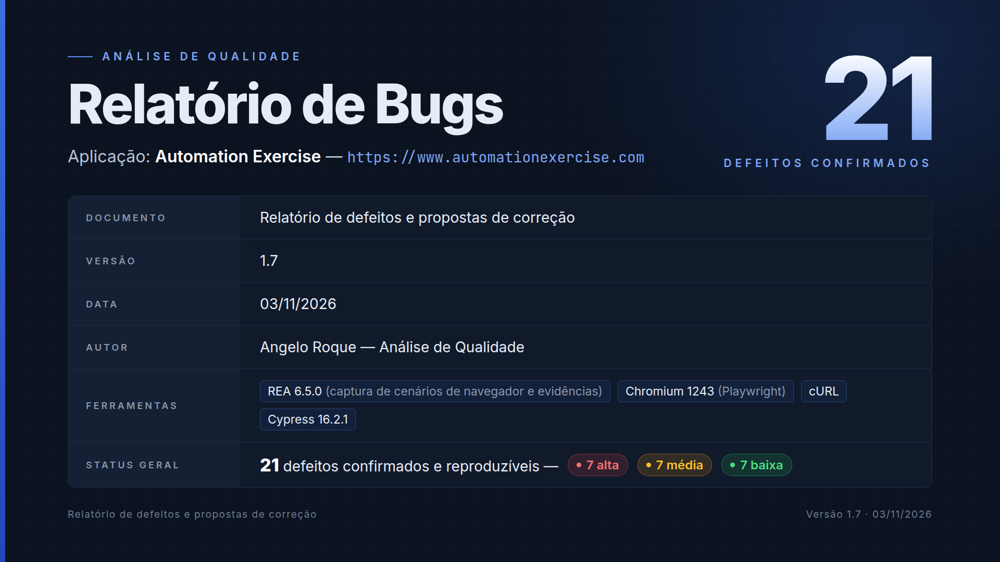

# Automation Exercise - Testes E2E com Cypress

[](https://github.com/Arckangelo/automationexercise-cypress-tests/actions/workflows/cypress.yml)

[](https://github.com/Arckangelo/automationexercise-cypress-tests/actions/workflows/security.yml)

[](https://github.com/Arckangelo/automationexercise-cypress-tests/actions/workflows/codeql.yml)

📊 [Relatório HTML da última execução](https://arckangelo.github.io/automationexercise-cypress-tests/) (gerado e publicado pelo CI) · 🐞 [Relatório de bugs (PDF)](docs/Relatorio_de_Bugs.pdf) · [BUGS.md](BUGS.md)

Suíte de testes automatizados end-to-end para o site [AutomationExercise](https://automationexercise.com), um e-commerce fictício criado para prática de automação de testes.

**Resumo**

- **59 testes** na suíte principal: 36 de interface (login, logout, cadastro, exclusão de conta, busca, filtros, detalhes do produto, carrinho e compra completa) e 23 de API.
- **21 bugs encontrados** no site e na API (7 de severidade alta), cada um com um teste de regressão que falha enquanto o bug existir. Estão documentados em [BUGS.md](BUGS.md) e no [relatório em PDF](docs/Relatorio_de_Bugs.pdf).
- **Testes independentes e sem dados fixos:** cada execução cria um usuário descartável pela API e o remove ao final. O carrinho é preparado por HTTP, para que um teste não dependa de outro.
- **Checagens que pegam erros reais:** valores exatos em vez de "contém", persistência conferida depois de recarregar a página e asserções reforçadas por análise de mutação.
- **CI no GitHub Actions:** a suíte roda no Chrome, no Firefox e no Edge a cada push e diariamente, o relatório HTML é publicado no GitHub Pages e o pipeline tem verificações de segurança (gitleaks, npm audit, CodeQL).

> Veja também meu [projeto em Python + Playwright](https://github.com/Arckangelo/saucedemo-playwright-python), com testes E2E do SauceDemo.

## 🎯 Objetivo

Projeto desenvolvido para praticar e demonstrar habilidades em automação de testes, cobrindo fluxos essenciais de um e-commerce: autenticação, cadastro, navegação, busca, filtros e o fluxo completo de compra (carrinho e checkout).

## 🛠️ Tecnologias

- [Cypress](https://www.cypress.io/) 16 - Framework de testes E2E
- JavaScript
- Mocha/Chai (assertions, nativos do Cypress)
- Testes de API com `cy.request` (nativo do Cypress, sem lib extra)
- [cypress-mochawesome-reporter](https://github.com/LironEr/cypress-mochawesome-reporter) - Relatório HTML com screenshots das falhas
- GitHub Actions para integração contínua e GitHub Pages para publicar o relatório
- gitleaks, npm audit, Dependabot e CodeQL para a segurança do pipeline (DevSecOps)
- REA, cURL e o Chromium do Playwright: usados na investigação e na captura de evidências dos bugs, não na suíte de testes

## ✅ O que é testado

### UI

| Arquivo | Cobertura |
|---|---|
| `login.cy.js` | Login com o usuário certo, senha incorreta e e-mail não cadastrado (sem logar), campos obrigatórios e logout com a sessão invalidada no servidor |
| `signup.cy.js` | Cadastro completo com os dados conferidos no servidor pela API, bloqueio de e-mail já cadastrado e de e-mail em formato inválido (as contas são removidas ao final) |
| `delete-account.cy.js` | Exclusão da conta pela tela: sessão encerrada e login recusado na tela e na API |
| `search.cy.js` | Busca que mostra **exatamente** os produtos com o termo (comparados ao catálogo da API), sem diferenciar maiúsculas, ignorando espaço no fim, e busca sem resultados |
| `filter.cy.js` | Filtros por categoria (Women > Dress, Men > Jeans) e por marca (Polo) mostrando **exatamente** os produtos do catálogo, e contagem de cada marca na lateral |
| `product-details.cy.js` | Nome, preço, categoria e marca iguais aos da API numa amostra por **partição de equivalência** (cada categoria, cada marca, preços extremos, nome mais longo, último ID, `&` no texto) mais 1 produto **sorteado** a cada execução; link "View Product", adição com quantidade e imagem. O formato de todo o catálogo é conferido pela API |
| `checkout.cy.js` | Carrinho (adicionar, somar quantidade, remover com verificação após recarregar, carrinho vazio) e checkout (itens, total, endereço, bloqueio sem login e compra completa com fatura) |
| `cart-session.cy.js` | Carrinho entre sessões: do visitante para a conta, depois do logout, em outro navegador e soma com o carrinho da conta |

**Total: 36 testes automatizados**

### API

A [API pública do AutomationExercise](https://automationexercise.com/api_list) responde sempre com HTTP 200,
mesmo em erro — quem indica sucesso ou falha é o campo `responseCode` do corpo da resposta. Os testes abaixo
validam isso explicitamente, em vez de confiar no status HTTP.

| Arquivo | Cobertura |
|---|---|
| `products.api.cy.js` | Formato de **todos** os produtos e marcas (campos, IDs únicos, padrão de preço), marcas coerentes com o catálogo e rejeição de método não suportado |
| `search.api.cy.js` | Busca em que **cada** resultado contém o termo, busca sem resultados e erro 400 sem o parâmetro |
| `login.api.cy.js` | Verificação de login: credenciais válidas, senha incorreta, usuário inexistente, e-mail ou senha faltando e recusa de GET, PUT, DELETE e PATCH |
| `account.api.cy.js` | Criar, consultar, atualizar e remover conta, conferindo o efeito no servidor; permissões (atualizar ou apagar com senha errada não altera a conta), e-mail duplicado e cada campo obrigatório ausente. Cada teste usa a própria conta descartável |

**Total: 23 testes automatizados**

**Suíte completa: 59 testes (36 de UI + 23 de API)**

### 🐞 Bugs conhecidos

Em quatro rodadas de exploração foram encontrados **21 bugs** no site e na API, documentados com
passos de reprodução, resultado esperado e obtido, causa raiz e proposta de correção:

<p align="center"><a href="docs/Relatorio_de_Bugs.pdf"></a></p>

- **[BUGS.md](BUGS.md)**: versão resumida, para leitura rápida no GitHub
- **[Relatório de Bugs (PDF)](docs/Relatorio_de_Bugs.pdf)**: relatório completo, com análise de causa raiz, soluções propostas e plano de correção.
  O PDF e a capa são gerados a partir de [`docs/relatorio/`](docs/relatorio/) com `docs/relatorio/gerar.sh` (Chrome ou Chromium)

| ID | Severidade | Resumo |
|---|---|---|
| BUG-01 | Alta | Carrinho aceita quantidade negativa (total negativo) |
| BUG-02 | Média | Carrinho aceita quantidade zero |
| BUG-03 | Baixa | Fontes bloqueadas por Mixed Content (`@import http://` no CSS) |
| BUG-04 | Média | API retorna HTTP 200 em respostas de erro, com formato e cabeçalho `Allow` incoerentes entre métodos |
| BUG-05 | Baixa | API serve JSON com `Content-Type: text/html` |
| BUG-06 | Alta | `GET /delete_account` exclui a conta logada sem confirmação nem token CSRF |
| BUG-07 | Alta | API `getUserDetailByEmail` expõe dados pessoais sem autenticação |
| BUG-08 | Alta | *Contact Us* exibe "Success!" mas a mensagem nunca é enviada |
| BUG-09 | Média | Quantidade vazia, decimal ou `1e2` gera HTTP 500 com página de debug |
| BUG-10 | Média | Assinatura da newsletter exibe sucesso sem enviar nada ao servidor |
| BUG-11 | Média | Avaliação de produto exibe agradecimento sem enviar nada ao servidor |
| BUG-12 | Alta | Sem login, `/checkout` e `/payment` abrem pela URL e o pagamento é aceito: o pedido é confirmado |
| BUG-13 | Baixa | Com o carrinho vazio, `/checkout` mostra total Rs. 0 e o botão *Place Order*, e o pagamento confirma um pedido de Rs. 0 |
| BUG-14 | Baixa | API `brandsList` repete a marca de cada produto (34 itens para 8 marcas) |
| BUG-15 | Baixa | Busca com espaço duplo não encontra nada, e um `&` no termo corta a busca e mostra produtos errados |
| BUG-16 | Alta | Confirmação de pedido e fatura de qualquer valor gerados pela URL, sem sessão nem compra |
| BUG-17 | Baixa | API `updateAccount` com senha errada responde 404 "Account not found!", embora a conta exista |
| BUG-18 | Média | Cadastro aceita e-mail em formato inválido pela API e pelo formulário (só o navegador valida) |
| BUG-19 | Média | Campos obrigatórios do cadastro aceitam valor vazio, inclusive a senha (API e formulário) |
| BUG-20 | Alta | Pagamento aceita qualquer dado de cartão (vazio, com letras, vencido) e confirma o pedido |
| BUG-21 | Baixa | Produto inexistente abre página vazia com HTTP 200, e o carrinho responde "Added To Cart" |

Cada bug tem um **teste de regressão** em `cypress/e2e/known-bugs/` (46 testes). Esses testes descrevem
o comportamento correto e, por isso, **falham enquanto o bug existir**. Eles ficam fora da suíte
principal (`npm test`) e rodam num job separado do CI, que não quebra o pipeline e roda também
**diariamente**, para acompanhar se algum bug foi corrigido. Localmente: `npm run test:bugs`.

## 🧹 Dados que os testes criam

Os testes rodam no site público, então tudo o que eles enviam fica gravado lá. Todo dado enviado é
marcado como teste (nome "QA Automatizado", e-mails `qa.*@teste.com`, textos com "teste automatizado
(QA)"), para poder ser identificado e apagado por quem administra o site.

- **Contas:** criadas com e-mail único (`qa.<id>@teste.com`) e apagadas ao final de cada teste ou
  `describe`, por um hook que roda mesmo quando o teste falha. **Não ficam no site.**
- **Carrinho:** fica preso à conta descartável ou à sessão do visitante e some com elas.
- **Pedidos:** **ficam no site**, porque ele não oferece forma de apagá-los. Todo teste que cria pedido
  leva a tag `@creates-order` (ver a seção Tags), e a regra é conferida automaticamente. Num PR, o CI
  confirma 4 pedidos: a compra completa de `checkout.cy.js` nos três navegadores e na fumaça no celular;
  os testes de bug que pagam ficam de fora. No push na `main` são 9 (mais 4 do BUG-20 e 1 do BUG-13) e
  na execução diária, 10 (mais a suíte inteira no celular).
  Todos são feitos com contas descartáveis, apagadas logo depois, e com o cartão fictício de `users.json`.
- **Formulários (Contact Us, newsletter, avaliação):** hoje nada é enviado, porque esse é o próprio
  bug (BUG-08, 10 e 11). Quando o site corrigir, esses testes passarão a enviar mensagens reais a cada
  execução; o aviso está no cabeçalho de `forms-not-submitted.cy.js`.

## 🏷️ Tags

Os testes podem ter tags, filtradas com o [`@cypress/grep`](https://github.com/cypress-io/cypress/tree/develop/npm/grep).
Só duas existem, e a lista é conferida no CI ([`scripts/test-tags.js`](scripts/test-tags.js)):

| Tag | Significado | Onde vale |
|---|---|---|
| `@smoke` | Fluxo crítico: login, cadastro, busca, detalhe do produto, compra completa e criação de conta pela API (6 testes, ~1 min) | `npm run test:smoke`, para conferir rápido |
| `@creates-order` | O teste confirma um pedido no site, que não pode ser apagado | Nos PRs, o job de bugs conhecidos pula esses testes (`npm run test:bugs:pr`). Push na `main`, execução diária e manual rodam todos. A suíte principal nunca filtra |

Como marcar: `it('...', { tags: ['@smoke'] }, () => { ... })`, ou nas opções do `describe` para valer em
todos os testes dele.

**Proteções:**
- **Só tags da lista, sempre como texto literal** (`npm run check:tags`, no CI): uma tag digitada errada
  tiraria o teste do filtro sem ninguém perceber.
- **`@creates-order` conferida pelo que aconteceu:** cada execução registra os testes que de fato
  confirmaram um pedido (pela tela e por `cy.request`), e `npm run check:orders` compara com as tags do
  código. Pedido sem a tag falha o CI; tag sem pedido gera aviso, para ela não sobrar. Os títulos gerados a
  partir de listas são casados por padrão; um teste que não case com certeza também falha.
- **Filtro sem resultados falha:** antes de abrir o navegador, se nenhum spec tiver teste com a tag, e
  ao final, se nenhum teste tiver rodado. Uma execução filtrada nunca termina verde sem ter testado nada.
- **Resumo honesto:** com filtro, o resumo dos bugs diz "execução parcial" e lista os bugs não avaliados.

## ✍️ Convenções do código

- **Idioma:** identificadores (variáveis, funções, comandos customizados, arquivos de código, chaves das fixtures) em inglês; comentários, títulos dos testes, mensagens, documentação, commits e PRs em português
- **Formatação:** Prettier ([`.prettierrc.json`](.prettierrc.json)) e [`.editorconfig`](.editorconfig). Antes do commit: `npm run format`. O CI confere com `npm run format:check`
- **IDs de caso de teste:** cada `it` tem um comentário `// CT-<ÁREA>-<ARQUIVO>-NN`; testes de bug conhecido começam com `[BUG-NN]`

## 📁 Estrutura do projeto
```
.github/
├── dependabot.yml               # atualizações semanais de dependências npm e das actions
└── workflows/
    ├── cypress.yml              # CI: suíte principal, bugs conhecidos e publicação do relatório
    ├── security.yml             # segredos (gitleaks) e dependências vulneráveis (npm audit)
    └── codeql.yml               # análise estática do JavaScript e dos workflows
docs/
├── Relatorio_de_Bugs.pdf        # relatório completo de bugs (gerado)
├── img/capa-relatorio.png       # capa do relatório usada neste README (gerada)
└── relatorio/                   # fontes HTML do PDF e da capa, e o gerar.sh que os produz
.editorconfig                    # padrão de formatação para o editor (igual ao Prettier)
.git-blame-ignore-revs           # commits só de formatação, ignorados pelo git blame
.nvmrc                           # versão do Node usada localmente e no CI
.prettierrc.json                 # padrão de formatação do código (npm run format)
.gitleaks.toml                   # regras do gitleaks e exceções comentadas para falsos positivos
.pre-commit-config.yaml          # hook local opcional que bloqueia segredos antes do commit
BUGS.md                          # resumo dos bugs encontrados
SECURITY.md                      # política de reporte de vulnerabilidades
cypress/
├── e2e/
│   ├── api/
│   │   ├── account.api.cy.js    # cenários da API de conta (criar, consultar, atualizar, remover)
│   │   ├── login.api.cy.js      # cenários de login via API
│   │   ├── products.api.cy.js   # cenários de produtos via API
│   │   └── search.api.cy.js     # cenários de busca via API
│   ├── auth/
│   │   ├── login.cy.js          # cenários de login e logout via UI
│   │   ├── delete-account.cy.js # exclusão de conta via UI
│   │   └── signup.cy.js         # cenários de teste de cadastro via UI
│   ├── cart/
│   │   ├── cart-session.cy.js   # carrinho entre login, logout e outro navegador
│   │   └── checkout.cy.js       # cenários de carrinho, checkout e compra completa
│   ├── known-bugs/              # testes de regressão de bugs conhecidos (fora da suíte padrão)
│   │   ├── api-brands.cy.js           # BUG-14: lista de marcas repetida na API
│   │   ├── account-security.cy.js     # BUG-06/07/17: exclusão de conta por GET, dados expostos e erro de senha na API
│   │   ├── api-http-status.cy.js      # BUG-04/05: status HTTP, formato, cabeçalho Allow e Content-Type da API
│   │   ├── cart-quantity.cy.js        # BUG-01/02/09: quantidade negativa, zero e não inteira
│   │   ├── checkout-access.cy.js      # BUG-12/13: checkout e pagamento sem login ou com carrinho vazio
│   │   ├── email-format.cy.js         # BUG-18: e-mail em formato inválido aceito no cadastro
│   │   ├── forms-not-submitted.cy.js  # BUG-08/10/11: Contact Us, newsletter e avaliação sem envio
│   │   ├── mixed-content.cy.js        # BUG-03: @import http:// nas folhas de estilo
│   │   ├── order-confirmation.cy.js   # BUG-16: confirmação de pedido e fatura gerados pela URL
│   │   ├── payment-validation.cy.js   # BUG-20: pagamento aceita dados de cartão inválidos
│   │   ├── product-not-found.cy.js    # BUG-21: produto inexistente abre página vazia
│   │   ├── required-fields.cy.js      # BUG-19: campos obrigatórios do cadastro aceitam valor vazio
│   │   └── search-input.cy.js         # BUG-15: espaço duplo e "&" no termo da busca
│   └── products/
│       ├── filter.cy.js         # cenários de teste de filtro de produtos
│       ├── product-details.cy.js # página de detalhes comparada à API
│       └── search.cy.js         # cenários de teste de busca de produtos
├── fixtures/
│   ├── apiData.json             # massa de dados dos testes de API
│   └── users.json               # e-mails, senhas, e-mails inválidos e dados dos formulários; contas aleatórias seguem o modelo qa.{id}@teste.com
└── support/
    ├── catalog.js              # carrega o catálogo da API, fonte do que busca, filtro e carrinho devem mostrar
    ├── commands/                # comandos customizados, um arquivo por assunto (importados em e2e.js)
    │   ├── protection.js        # sobrescritas de cy.visit e cy.request: proteção contra a instabilidade do site
    │   ├── session.js           # login por HTTP, com cy.session, e pela tela
    │   ├── cart.js              # carrinho montado, lido e limpo por HTTP
    │   ├── ui.js                # leitura e ações na tela (texto, busca, pagamento)
    │   ├── forms.js             # formulários enviados sem a validação do navegador
    │   └── api.js               # cy.apiRequest e um comando por endpoint da API
    ├── e2e.js                   # configurações globais; carrega users.json no alias @users antes de cada teste
    ├── orders.js                # registra os pedidos que cada teste confirmou (conferido com a tag @creates-order)
    └── testUser.js        # gera credenciais aleatórias a partir de users.json e cria/remove a conta descartável dos testes com login
scripts/
├── cypress.js                   # roda o Cypress com um ambiente estável em qualquer sistema (usado pelos scripts npm)
├── bug-summary.js               # resumo teste a teste dos bugs conhecidos (usado no CI)
├── check-order-tags.js          # confere a tag @creates-order com os pedidos registrados na execução (CI)
├── check-tags.js                # só tags permitidas e como texto literal (CI)
├── flaky-summary.js             # testes da suíte principal que só passaram numa nova tentativa (usado no CI)
└── test-tags.js                 # lê testes e tags dos specs como código (usado pelos dois check-*)
```

## 🚀 Como rodar o projeto

**Pré-requisitos:** Node.js 24, a versão do [`.nvmrc`](.nvmrc) usada também no CI (com nvm: `nvm use`). Para rodar no Chrome, Firefox ou Edge, o navegador precisa estar
instalado; sem eles, os testes rodam no Electron, que já vem com o Cypress.

1. Clone o repositório
```bash
git clone https://github.com/Arckangelo/automationexercise-cypress-tests.git
cd automationexercise-cypress-tests
```

2. Instale as dependências (nas versões exatas do `package-lock.json`)
```bash
npm ci
```

3. Rode os testes

```bash
npm test               # roda toda a suíte sem abrir o navegador (no Electron)
npm run test:chrome    # a suíte no Chrome (também test:firefox e test:edge, como no CI)
npm run test:open      # abre a interface do Cypress
npm run test:smoke     # só os testes @smoke, no Chrome (~1 min)
npm run test:smoke:mobile  # os testes @smoke numa tela de celular (375x667)
npm run test:mobile    # a suíte inteira numa tela de celular (no CI, só na execução diária)
npm run test:bugs      # roda só os testes de bugs conhecidos (falham enquanto os bugs existirem)
npm run test:bugs:pr   # bugs conhecidos sem os testes que criam pedido (como nos PRs)
npm run check:tags     # confere as tags dos specs
```

Os scripts passam pelo [`scripts/cypress.js`](scripts/cypress.js), que corrige duas variáveis de ambiente
que travam o Electron em algumas máquinas: a sessão gráfica Wayland (padrão no Ubuntu e no Fedora) e o
`ELECTRON_RUN_AS_NODE` que editores como o VS Code repassam. Por isso prefira `npm run` a `npx cypress`.

Na interface, escolha **E2E Testing** → selecione um navegador → clique em qualquer arquivo `.cy.js` para rodar.

Cada execução headless gera um relatório HTML em `cypress/reports/` (`suite/` ou `known-bugs/`).

## ⚙️ Integração contínua

O workflow [`cypress.yml`](.github/workflows/cypress.yml) roda a cada push e pull request na `main`, e diariamente às 06:00 UTC:

| Job | O que faz |
|---|---|
| Formatação e tags | Confere a formatação com o Prettier (`npm run format:check`) e as tags dos specs (`npm run check:tags`) |
| Suíte principal | Roda os 59 testes no Chrome, no Firefox e no Edge, em paralelo; salva as screenshots das falhas e um relatório HTML por navegador; confere a tag `@creates-order` com os pedidos criados. No Chrome, roda também os testes `@smoke` numa tela de celular (375x667) |
| Suíte no celular (diária) | Roda a suíte inteira numa tela de celular, só na execução diária e na manual |
| Bugs conhecidos | Roda os 46 testes de regressão no Chrome (num PR, sem os de `@creates-order`), sem quebrar o pipeline, e lista no resumo, teste a teste, cada bug que parou de reproduzir (com aviso em destaque), mesmo que os outros continuem falhando |
| Publicar relatório | Publica os relatórios HTML (um por navegador e o dos bugs conhecidos) no [GitHub Pages](https://arckangelo.github.io/automationexercise-cypress-tests/) (só a partir da `main`) |

## 🔒 Segurança do pipeline

Além dos testes, o CI aplica práticas de DevSecOps para proteger o próprio repositório:

| Ferramenta | O que detecta | Quando roda |
|---|---|---|
| [gitleaks](https://github.com/gitleaks/gitleaks) ([`security.yml`](.github/workflows/security.yml)) | Segredos (tokens, chaves, senhas) em **todo o histórico** do git; resultados também na aba *Security* | Push e PR na `main`, semanalmente e no hook local opcional |
| `npm audit` ([`security.yml`](.github/workflows/security.yml)) | Dependências com vulnerabilidade conhecida; falha só em severidade **alta ou crítica** | Push e PR na `main` e semanalmente |
| [Dependabot](.github/dependabot.yml) | Versões desatualizadas ou vulneráveis de pacotes npm e das GitHub Actions; abre PRs agrupando atualizações menores | Semanalmente |
| [CodeQL](https://codeql.github.com/) ([`codeql.yml`](.github/workflows/codeql.yml)) | Falhas de segurança no JavaScript e nos próprios workflows (ex.: injeção de expressões, permissões excessivas) | Push e PR na `main` e semanalmente |

**Endurecimento dos workflows**

- `permissions: contents: read` no topo de cada workflow; permissões extras só no job que precisa
  (ex.: `security-events: write` no CodeQL e no gitleaks, `pages`/`id-token` no deploy do Pages).
- Todas as actions fixadas pelo **SHA completo do commit**, com a versão em comentário. Uma tag
  pode ser movida para código malicioso; um SHA não. O Dependabot mantém esses SHAs atualizados.
- O gitleaks roda pelo binário oficial com versão e checksum SHA-256 fixos.
- Falsos positivos ficam em [`.gitleaks.toml`](.gitleaks.toml), com exceções específicas (arquivo **e** valor) e comentadas.

**Hook local (opcional)**

Para barrar um segredo antes mesmo do commit:

```bash
pip install pre-commit
pre-commit install            # instala o hook neste clone
pre-commit run --all-files    # (opcional) varre o repositório inteiro uma vez
```

Para reportar uma vulnerabilidade, veja [SECURITY.md](SECURITY.md).

## 📝 Observações

- Os testes usam geração de emails aleatórios para evitar conflitos de dados duplicados
- O carrinho é limpo automaticamente antes de cada teste via requisição HTTP direta (`cy.request`), sem passar pela interface — mais rápido e estável que remover item por item na UI
- Os testes de carrinho aguardam a confirmação real do servidor (`cy.intercept`/`cy.wait`) em vez de usar esperas fixas (`cy.wait(ms)`)
- Seletores robustos (baseados em atributos `data-qa` e `href`) foram priorizados para reduzir flakiness
- **Celular:** o site é responsivo, então os fluxos críticos (`@smoke`) rodam também numa tela de 375x667 em todo PR, e a suíte inteira roda nessa tela uma vez por dia (`--env mobile=true`, relatório em `cypress/reports/mobile`). A tela pequena simula o layout do celular, mas não toque nem navegadores móveis (Safari do iPhone, Chrome do Android)
- Nenhum erro JavaScript da página é ignorado (`cypress/support/e2e.js`); quando vem de um script de terceiros, a falha lista os domínios de terceiros que rodaram na página
- O site é público e às vezes responde *"heavy load (queue full)"*; por isso, no modo headless cada teste tem 1 nova tentativa (`retries`), exceto os de bugs conhecidos, em que a falha é o resultado esperado. A instabilidade do próprio site é tratada antes, na requisição (veja abaixo)
- Sob carga, o site também pode responder uma **página de espera** no lugar da página ou do JSON. `cy.visit` e `cy.request` (e, por ele, a API e todo comando que lê páginas por HTTP) reconhecem essa página (falta o logo do site), tentam de novo até 3 vezes e, se ela persistir, falham com *"Site indisponível"*: assim nenhum teste passa ou vira bug por causa dela. A página fica salva em `cypress/reports/pagina-de-espera.html` (artefato `pagina-de-espera-*` no CI). Ver [waitPage.js](cypress/support/waitPage.js)
- Quando o site está fora do ar ou sobrecarregado (`429`, `502`-`504` e os `520`-`524` da Cloudflare), o `cy.request` repete só aquela requisição, até 3 vezes, em vez de o Cypress repetir o teste inteiro. Depois que o site é declarado indisponível, um **disjuntor** faz as próximas falhas do mesmo tipo acontecerem na hora, sem novas esperas, até o site responder normalmente de novo
- Testes que só passam numa nova tentativa (`retries`) aparecem no resumo do CI como **instáveis**, com aviso em destaque ([`scripts/flaky-summary.js`](scripts/flaky-summary.js)): a nova tentativa não esconde a instabilidade
- Anúncios e rastreadores de terceiros são bloqueados (`blockHosts` no `cypress.config.js`): deixam as páginas mais lentas e não fazem parte do site testado. Nenhuma exceção da página é ignorada: se um script de terceiros lançar erro, a falha lista os domínios de terceiros que rodaram na página, para o novo provedor ser acrescentado ao `blockHosts`
- Nos testes em que o login é só preparação (`cy.login`, carrinho entre sessões), ele é feito por HTTP com `cy.loginByRequest`; o login pela tela é coberto em `login.cy.js`
- **Os testes provisionam os próprios dados:** os specs que precisam de login criam uma conta descartável via API num `before()` e a removem num `after()` (`cypress/support/testUser.js`). Nenhuma credencial fica no repositório e a suíte não depende de uma conta fixa

## 👤 Autor

**Angelo Roque** · [GitHub](https://github.com/Arckangelo) · [LinkedIn](https://www.linkedin.com/in/angelo-roque-223b6b259/)