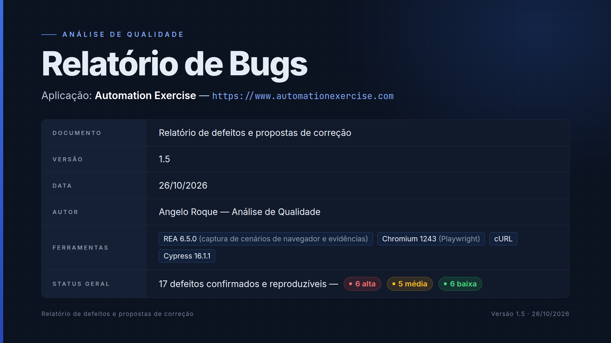

# Automation Exercise - Testes E2E com Cypress

[](https://github.com/Arckangelo/automationexercise-cypress-tests/actions/workflows/cypress.yml)

[](https://github.com/Arckangelo/automationexercise-cypress-tests/actions/workflows/security.yml)

[](https://github.com/Arckangelo/automationexercise-cypress-tests/actions/workflows/codeql.yml)

📊 [Relatório HTML da última execução](https://arckangelo.github.io/automationexercise-cypress-tests/) (gerado e publicado pelo CI) · 🐞 [Relatório de bugs (PDF)](docs/Relatorio_de_Bugs.pdf) · [BUGS.md](BUGS.md)

Suíte de testes automatizados end-to-end para o site [AutomationExercise](https://automationexercise.com), um e-commerce fictício criado para prática de automação de testes.

**Resumo**

- **48 testes** na suíte principal: 26 de interface (login, logout, cadastro, busca, filtros, carrinho e checkout) e 22 de API.
- **17 bugs encontrados** no site e na API (6 de severidade alta), cada um com um teste de regressão que falha enquanto o bug existir. Estão documentados em [BUGS.md](BUGS.md) e no [relatório em PDF](docs/Relatorio_de_Bugs.pdf).
- **Testes independentes e sem dados fixos:** cada execução cria um usuário descartável pela API e o remove ao final. O carrinho é preparado por HTTP, para que um teste não dependa de outro.
- **Checagens que pegam erros reais:** valores exatos em vez de "contém", persistência conferida depois de recarregar a página e asserções reforçadas por análise de mutação.
- **CI no GitHub Actions:** a suíte roda a cada push e diariamente, o relatório HTML é publicado no GitHub Pages e o pipeline tem verificações de segurança (gitleaks, npm audit, CodeQL).

> Veja também meu [projeto em Python + Playwright](https://github.com/Arckangelo/saucedemo-playwright-python), com testes E2E do SauceDemo.

## 🎯 Objetivo

Projeto desenvolvido para praticar e demonstrar habilidades em automação de testes, cobrindo fluxos essenciais de um e-commerce: autenticação, cadastro, navegação, busca, filtros e o fluxo completo de compra (carrinho e checkout).

## 🛠️ Tecnologias

- [Cypress](https://www.cypress.io/) 16 - Framework de testes E2E
- JavaScript
- Mocha/Chai (assertions, nativos do Cypress)
- Testes de API com `cy.request` (nativo do Cypress, sem lib extra)
- [cypress-mochawesome-reporter](https://github.com/LironEr/cypress-mochawesome-reporter) - Relatório HTML com screenshots das falhas
- GitHub Actions para integração contínua e GitHub Pages para publicar o relatório
- gitleaks, npm audit, Dependabot e CodeQL para a segurança do pipeline (DevSecOps)
- REA, cURL e o Chromium do Playwright: usados na investigação e na captura de evidências dos bugs, não na suíte de testes

## ✅ O que é testado

### UI

| Arquivo | Cobertura |
|---|---|
| `login.cy.js` | Login com o usuário certo, senha incorreta e e-mail não cadastrado (sem logar), campos obrigatórios e logout com a sessão invalidada no servidor |
| `signup.cy.js` | Cadastro completo com os dados conferidos no servidor pela API, e bloqueio de e-mail já cadastrado (as contas são removidas ao final) |
| `search.cy.js` | Busca que mostra **exatamente** os produtos com o termo (comparados ao catálogo da API), sem diferenciar maiúsculas, ignorando espaço no fim, e busca sem resultados |
| `filter.cy.js` | Filtros por categoria (Women > Dress, Men > Jeans) e por marca (Polo) mostrando **exatamente** os produtos do catálogo, e contagem de cada marca na lateral |
| `checkout.cy.js` | Carrinho (adicionar, somar quantidade, remover com verificação após recarregar, carrinho vazio) e checkout (itens, total, endereço, pagamento e bloqueio sem login) |

**Total: 26 testes automatizados**

### API

A [API pública do AutomationExercise](https://automationexercise.com/api_list) responde sempre com HTTP 200,
mesmo em erro — quem indica sucesso ou falha é o campo `responseCode` do corpo da resposta. Os testes abaixo
validam isso explicitamente, em vez de confiar no status HTTP.

| Arquivo | Cobertura |
|---|---|
| `products.api.cy.js` | Formato de **todos** os produtos e marcas (campos, IDs únicos, padrão de preço), marcas coerentes com o catálogo e rejeição de método não suportado |
| `search.api.cy.js` | Busca em que **cada** resultado contém o termo, busca sem resultados e erro 400 sem o parâmetro |
| `login.api.cy.js` | Verificação de login: credenciais válidas, senha incorreta, usuário inexistente, e-mail ou senha faltando e método não suportado |
| `account.api.cy.js` | Criar, consultar, atualizar e remover conta, conferindo o efeito no servidor; permissões (atualizar ou apagar com senha errada não altera a conta), e-mail duplicado e dados incompletos. Cada teste usa a própria conta descartável |

**Total: 22 testes automatizados**

**Suíte completa: 48 testes (26 de UI + 22 de API)**

### 🐞 Bugs conhecidos

Em três rodadas de exploração foram encontrados **17 bugs** no site e na API, documentados com
passos de reprodução, resultado esperado e obtido, causa raiz e proposta de correção:

<p align="center"><a href="docs/Relatorio_de_Bugs.pdf"></a></p>

- **[BUGS.md](BUGS.md)**: versão resumida, para leitura rápida no GitHub
- **[Relatório de Bugs (PDF)](docs/Relatorio_de_Bugs.pdf)**: relatório completo, com análise de causa raiz, soluções propostas e plano de correção.
  O PDF e a capa são gerados a partir de [`docs/relatorio/`](docs/relatorio/) com `docs/relatorio/gerar.sh` (Chrome ou Chromium)

| ID | Severidade | Resumo |
|---|---|---|
| BUG-01 | Alta | Carrinho aceita quantidade negativa (total negativo) |
| BUG-02 | Média | Carrinho aceita quantidade zero |
| BUG-03 | Baixa | Fontes bloqueadas por Mixed Content (`@import http://` no CSS) |
| BUG-04 | Média | API retorna HTTP 200 em respostas de erro |
| BUG-05 | Baixa | API serve JSON com `Content-Type: text/html` |
| BUG-06 | Alta | `GET /delete_account` exclui a conta logada sem confirmação nem token CSRF |
| BUG-07 | Alta | API `getUserDetailByEmail` expõe dados pessoais sem autenticação |
| BUG-08 | Alta | *Contact Us* exibe "Success!" mas a mensagem nunca é enviada |
| BUG-09 | Média | Quantidade vazia, decimal ou `1e2` gera HTTP 500 com página de debug |
| BUG-10 | Média | Assinatura da newsletter exibe sucesso sem enviar nada ao servidor |
| BUG-11 | Média | Avaliação de produto exibe agradecimento sem enviar nada ao servidor |
| BUG-12 | Alta | Sem login, `/checkout` e `/payment` abrem pela URL e o pagamento é aceito: o pedido é confirmado |
| BUG-13 | Baixa | Com o carrinho vazio, `/checkout` mostra total Rs. 0 e o botão *Place Order* |
| BUG-14 | Baixa | API `brandsList` repete a marca de cada produto (34 itens para 8 marcas) |
| BUG-15 | Baixa | Busca com espaço duplo não encontra nada, e um `&` no termo corta a busca e mostra produtos errados |
| BUG-16 | Alta | Confirmação de pedido e fatura de qualquer valor gerados pela URL, sem sessão nem compra |
| BUG-17 | Baixa | API `updateAccount` com senha errada responde 404 "Account not found!", embora a conta exista |

Cada bug tem um **teste de regressão** em `cypress/e2e/known-bugs/` (26 testes). Esses testes descrevem
o comportamento correto e, por isso, **falham enquanto o bug existir**. Eles ficam fora da suíte
principal (`npm test`) e rodam num job separado do CI, que não quebra o pipeline e roda também
**diariamente**, para acompanhar se algum bug foi corrigido. Localmente: `npm run test:bugs`.

## 📁 Estrutura do projeto
```
.github/
├── dependabot.yml               # atualizações semanais de dependências npm e das actions
└── workflows/
    ├── cypress.yml              # CI: suíte principal, bugs conhecidos e publicação do relatório
    ├── security.yml             # segredos (gitleaks) e dependências vulneráveis (npm audit)
    └── codeql.yml               # análise estática do JavaScript e dos workflows
docs/
├── Relatorio_de_Bugs.pdf        # relatório completo de bugs (gerado)
├── img/capa-relatorio.png       # capa do relatório usada neste README (gerada)
└── relatorio/                   # fontes HTML do PDF e da capa, e o gerar.sh que os produz
.gitleaks.toml                   # regras do gitleaks e exceções comentadas para falsos positivos
.pre-commit-config.yaml          # hook local opcional que bloqueia segredos antes do commit
BUGS.md                          # resumo dos bugs encontrados
SECURITY.md                      # política de reporte de vulnerabilidades
cypress/
├── e2e/
│   ├── api/
│   │   ├── account.api.cy.js    # cenários da API de conta (criar, consultar, atualizar, remover)
│   │   ├── login.api.cy.js      # cenários de login via API
│   │   ├── products.api.cy.js   # cenários de produtos via API
│   │   └── search.api.cy.js     # cenários de busca via API
│   ├── auth/
│   │   ├── login.cy.js          # cenários de login e logout via UI
│   │   └── signup.cy.js         # cenários de teste de cadastro via UI
│   ├── cart/
│   │   └── checkout.cy.js       # cenários de carrinho e checkout
│   ├── known-bugs/              # testes de regressão de bugs conhecidos (fora da suíte padrão)
│   │   ├── api-brands.cy.js           # BUG-14: lista de marcas repetida na API
│   │   ├── account-security.cy.js     # BUG-06/07/17: exclusão de conta por GET, dados expostos e erro de senha na API
│   │   ├── api-http-status.cy.js      # BUG-04/05: status HTTP e Content-Type da API
│   │   ├── cart-quantity.cy.js        # BUG-01/02/09: quantidade negativa, zero e não inteira
│   │   ├── checkout-access.cy.js      # BUG-12/13: checkout e pagamento sem login ou com carrinho vazio
│   │   ├── forms-not-submitted.cy.js  # BUG-08/10/11: Contact Us, newsletter e avaliação sem envio
│   │   ├── mixed-content.cy.js        # BUG-03: @import http:// nas folhas de estilo
│   │   ├── order-confirmation.cy.js   # BUG-16: confirmação de pedido e fatura gerados pela URL
│   │   └── search-input.cy.js         # BUG-15: espaço duplo e "&" no termo da busca
│   └── products/
│       ├── filter.cy.js         # cenários de teste de filtro de produtos
│       └── search.cy.js         # cenários de teste de busca de produtos
├── fixtures/
│   ├── apiData.json             # massa de dados dos testes de API
│   └── users.json               # dados de cenários negativos (senha incorreta, usuário inexistente)
└── support/
    ├── commands.js              # comandos customizados do Cypress
    ├── e2e.js                   # configurações globais carregadas antes dos testes
    └── usuarioDeTeste.js        # cria e remove a conta descartável usada nos testes com login
```

## 🚀 Como rodar o projeto

**Pré-requisitos:** Node.js instalado

1. Clone o repositório
```bash
git clone https://github.com/Arckangelo/automationexercise-cypress-tests.git
cd automationexercise-cypress-tests
```

2. Instale as dependências
```bash
npm install
```

3. Rode os testes

```bash
npm test             # roda toda a suíte sem abrir o navegador (como no CI)
npx cypress open     # abre a interface do Cypress
npm run test:bugs    # roda só os testes de bugs conhecidos (falham enquanto os bugs existirem)
```

Na interface, escolha **E2E Testing** → selecione um navegador → clique em qualquer arquivo `.cy.js` para rodar.

Cada execução headless gera um relatório HTML em `cypress/reports/` (`suite/` ou `known-bugs/`).

## ⚙️ Integração contínua

O workflow [`cypress.yml`](.github/workflows/cypress.yml) roda a cada push e pull request na `main`, e diariamente às 06:00 UTC:

| Job | O que faz |
|---|---|
| Suíte principal | Roda os 48 testes; salva as screenshots das falhas e o relatório HTML como artefatos |
| Bugs conhecidos | Roda os 26 testes de regressão sem quebrar o pipeline e indica no resumo se algum bug foi corrigido |
| Publicar relatório | Publica os dois relatórios HTML no [GitHub Pages](https://arckangelo.github.io/automationexercise-cypress-tests/) (só a partir da `main`) |

## 🔒 Segurança do pipeline

Além dos testes, o CI aplica práticas de DevSecOps para proteger o próprio repositório:

| Ferramenta | O que detecta | Quando roda |
|---|---|---|
| [gitleaks](https://github.com/gitleaks/gitleaks) ([`security.yml`](.github/workflows/security.yml)) | Segredos (tokens, chaves, senhas) em **todo o histórico** do git; resultados também na aba *Security* | Push e PR na `main`, semanalmente e no hook local opcional |
| `npm audit` ([`security.yml`](.github/workflows/security.yml)) | Dependências com vulnerabilidade conhecida; falha só em severidade **alta ou crítica** | Push e PR na `main` e semanalmente |
| [Dependabot](.github/dependabot.yml) | Versões desatualizadas ou vulneráveis de pacotes npm e das GitHub Actions; abre PRs agrupando atualizações menores | Semanalmente |
| [CodeQL](https://codeql.github.com/) ([`codeql.yml`](.github/workflows/codeql.yml)) | Falhas de segurança no JavaScript e nos próprios workflows (ex.: injeção de expressões, permissões excessivas) | Push e PR na `main` e semanalmente |

**Endurecimento dos workflows**

- `permissions: contents: read` no topo de cada workflow; permissões extras só no job que precisa
  (ex.: `security-events: write` no CodeQL e no gitleaks, `pages`/`id-token` no deploy do Pages).
- Todas as actions fixadas pelo **SHA completo do commit**, com a versão em comentário. Uma tag
  pode ser movida para código malicioso; um SHA não. O Dependabot mantém esses SHAs atualizados.
- O gitleaks roda pelo binário oficial com versão e checksum SHA-256 fixos.
- Falsos positivos ficam em [`.gitleaks.toml`](.gitleaks.toml), com exceções específicas (arquivo **e** valor) e comentadas.

**Hook local (opcional)**

Para barrar um segredo antes mesmo do commit:

```bash
pip install pre-commit
pre-commit install            # instala o hook neste clone
pre-commit run --all-files    # (opcional) varre o repositório inteiro uma vez
```

Para reportar uma vulnerabilidade, veja [SECURITY.md](SECURITY.md).

## 📝 Observações

- Os testes usam geração de emails aleatórios para evitar conflitos de dados duplicados
- O carrinho é limpo automaticamente antes de cada teste via requisição HTTP direta (`cy.request`), sem passar pela interface — mais rápido e estável que remover item por item na UI
- Os testes de carrinho aguardam a confirmação real do servidor (`cy.intercept`/`cy.wait`) em vez de usar esperas fixas (`cy.wait(ms)`)
- Seletores robustos (baseados em atributos `data-qa` e `href`) foram priorizados para reduzir flakiness
- Só exceções de scripts de anúncio de terceiros são ignoradas (`cypress/support/e2e.js`); qualquer outro erro JavaScript do site falha o teste
- O site é público e às vezes responde *"heavy load (queue full)"*; por isso, no modo headless cada teste tem até 2 novas tentativas (`retries`) — exceto os de bugs conhecidos, em que a falha é o resultado esperado
- **Os testes provisionam os próprios dados:** os specs que precisam de login criam uma conta descartável via API num `before()` e a removem num `after()` (`cypress/support/usuarioDeTeste.js`). Nenhuma credencial fica no repositório e a suíte não depende de uma conta fixa

## 👤 Autor

**Angelo Roque** · [GitHub](https://github.com/Arckangelo) · [LinkedIn](https://www.linkedin.com/in/angelo-roque-223b6b259/)